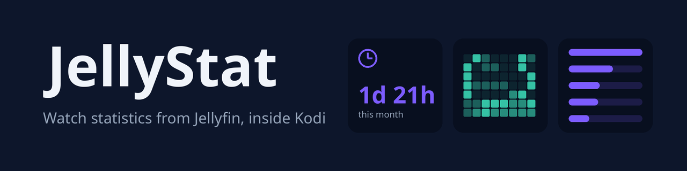
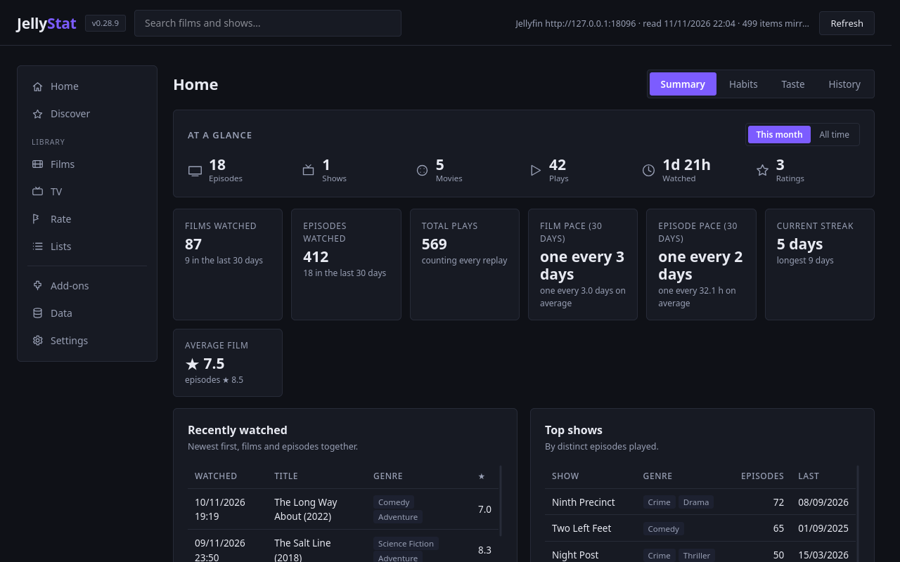
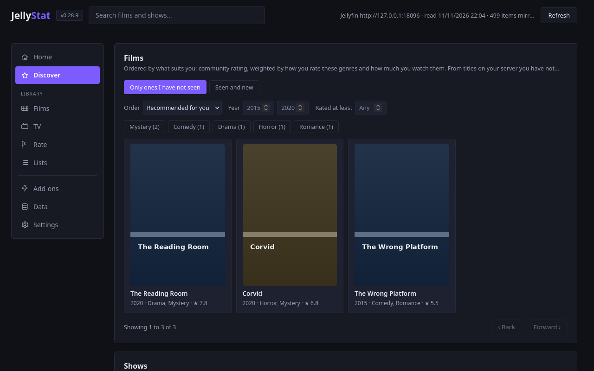
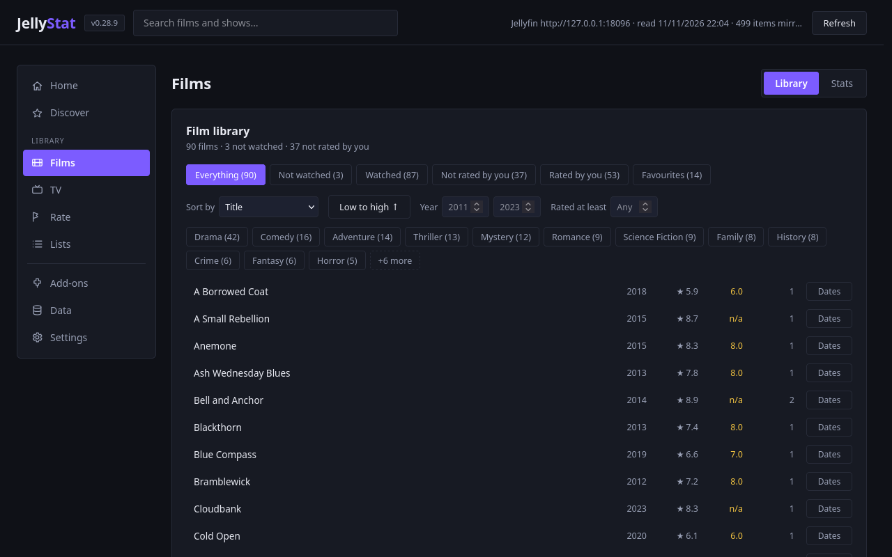
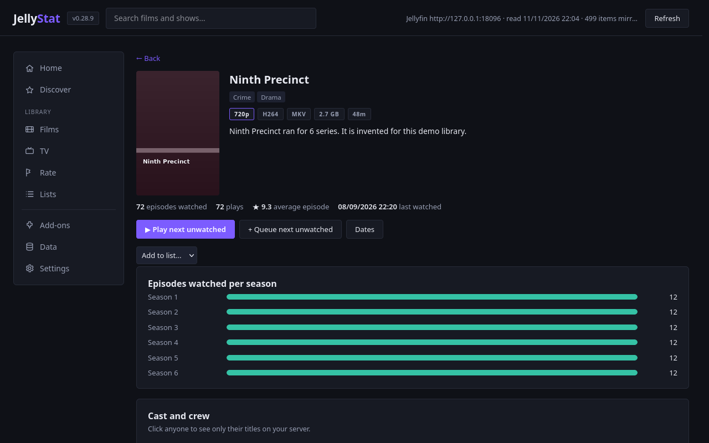
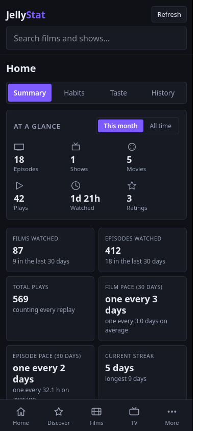

<a href="#quick-start">Quick start</a> · <a href="#features">Features</a> · <a href="#dashboard-and-security">Dashboard</a> · <a href="docs/SETTINGS.md">Settings</a> · <a href="#more">Docs</a> · <a href="../../releases">Changelog</a>

  
  
  
  
  
  

Shows what you have watched on Jellyfin, with genres, ratings and a web dashboard, instead of reading it off the server's own pages.

## Quick start

1. Install the [DeliciousCoffee repository](https://github.com/c0def0rc0ffee/DeliciousCoffee) once, then JellyStat from it, and Kodi keeps it up to date. Or download `script.jellystat-x.y.z.zip` from [Releases](../../releases) and use **Settings → Add-ons → Install from zip file** (switch on **Unknown sources** first).
2. Needs Kodi 19 (Matrix) or newer.
3. Signed in to **Jellyfin for Kodi**? JellyStat reuses that login. Otherwise enter your server URL and an API key in JellyStat's settings.
4. Run it from **Add-ons → Program add-ons → JellyStat**.

## Features

| | | |
|---|---|---|
| **Summary stats** Films and episodes watched, all time and recent, with genres and average ratings. | **Web dashboard** The same picture on a phone or laptop, served by the add-on itself. | **Screen time and play log** Every sitting logged with its date, clock time and how much was watched. |
| **Recommendations** Scored from your own history and ratings. Nothing leaves the box. | **Imports** Playback Reporting, Trakt, Letterboxd or another JellyStat box, previewed before anything is written. | **Ratings sync** Rate from the dashboard; the score is written to Jellyfin and read back from it. |
| **Lists and add-ons** Your own lists of titles, and settings for other add-ons from the dashboard. | **Skin properties** Headline figures as `JellyStat.*` window properties for any skin. | **Daily website snapshot** Optional: a genre summary sent to your own site once a day. |

## Screenshots

| | |
|---|---|
|  **Discover**: suggestions from your own watching. |  **Film library**: filter by watched, rated, favourite and genre. |
|  **A show's page**: badges, play on Kodi, episodes per season. |  **On a phone**: a bottom tab bar instead of the sidebar. |

Every screenshot comes from an invented demo library.

## Dashboard and security

Switch it on in **Settings → Web dashboard → Enable the web dashboard**, then press **Web dashboard address** to see what to type into a browser. The default port is 8099. It is built for a home network: plain HTTP, and the password is a household convenience. Never port forward it. Without a password it serves the Kodi box only.

## More

- [Web dashboard](docs/DASHBOARD.md)
- [Play log, imports and backups](docs/PLAY-LOG-AND-IMPORT.md)
- [Ratings](docs/RATINGS.md)
- [Lists and the Add-ons page](docs/LISTS-AND-ADDONS.md)
- [Window properties for skins](docs/SKINS.md)
- [Daily website snapshot](docs/WEBSITE-STATS.md)
- [Every setting](docs/SETTINGS.md)
- [How it is built](docs/ARCHITECTURE.md)

## Licence

[MIT](LICENSE)
